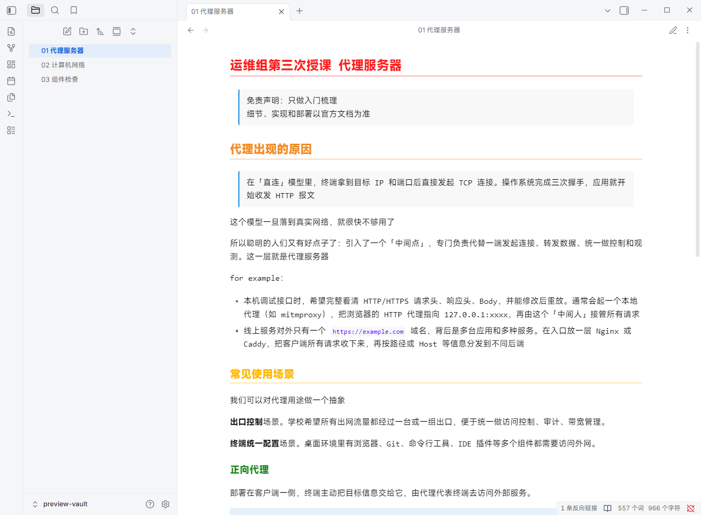
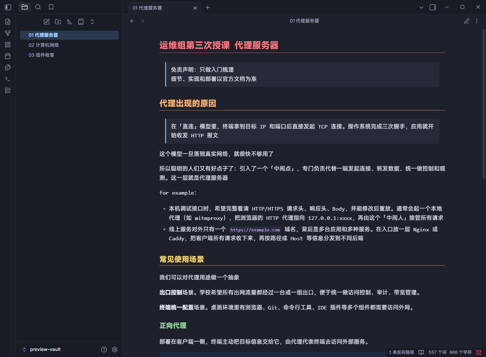

# Spectrum Notes

**Spectrum Notes** 是从两份 Obsidian 导出讲义的渲染重建的主题，同时支持浅色与深色模式。当前版本为持续试用中的 0.1.0，尚未提交社区。

## 安装

将 `theme.css` 和 `manifest.json` 放入你的笔记库 `.obsidian/themes/Spectrum Notes/`，然后在「设置 → 外观 → 主题」选择 Spectrum Notes。基础颜色选择浅色或深色即可，无需插件。

也可以直接用 Obsidian「打开本地仓库」打开本项目的 `preview-vault` 文件夹。内含两份原稿节选和组件检查页，已经配置好主题。预览库不会修改你的其他笔记库。

## 还原依据与边界

- 原稿：`运维组第二次授课 计网是什么.pdf`（38 页）与 `运维组第三次授课 代理服务器.pdf`（23 页）。
- PDF 提取的 H1–H4 颜色：`#fe1d1d`、`#f28c28`、`#ffb800`、`#228b22`。H1–H3 带对应颜色的细下划线。
- 标题相对正文的大小：1.5625、1.4375、1.3125、1.1875；两份 PDF 的绝对字号不同，相对比例一致。
- 引用背景 `#f8f8f8`，蓝色边线 `#419fe7`；代码背景 `#eff1f5`，紫色行内代码 `#4900ff`。
- 拉丁字符识别为 FiraCodeNF；中文是 Type3 子集，不能据此确定原字体。优先使用本地 Fira Code Nerd Font / Fira Code，其次 Consolas 与系统中文字体。未捆绑字体。用户在外观中手动指定的字体仍优先。
- 深色配色、应用侧栏、H5/H6 等未从 PDF 确认的部分为补充设计，不能声称找回原主题源码。
- 保留原稿浅色黄色标题的高亮风格；其白底对比度较低。如果日常阅读优先，可以在确认阶段调成深金色。

## 验证

在本机真实 Obsidian 独立测试库中加载，检查阅读模式、CodeMirror 实时预览、浅/深模式切换和 390px 窄窗口。截图见 `output/`。窄窗口检查不等同于移动端设备验证。

覆盖：H1–H6、引用、嵌套列表、任务、链接、高亮、表格、代码高亮、提示框、公式与脚注。打印 CSS 会把深色模式恢复为白底；PDF 分页并不承诺与原导出一致，原导出缩放、字体及源 Markdown 均不完整。

## 后续发布

上架准备和当前缺项见 [社区提交指南](PUBLISHING.md)。可以先提交可用的小版本，再通过 GitHub Release 持续更新。当前未创建 Release，未提交社区申请，尚未选定许可证。

实现参考 Obsidian 官方 [主题样例](https://github.com/obsidianmd/obsidian-sample-theme) 和 [CSS 变量](https://docs.obsidian.md/Reference/CSS%20variables/About%20styling)。
